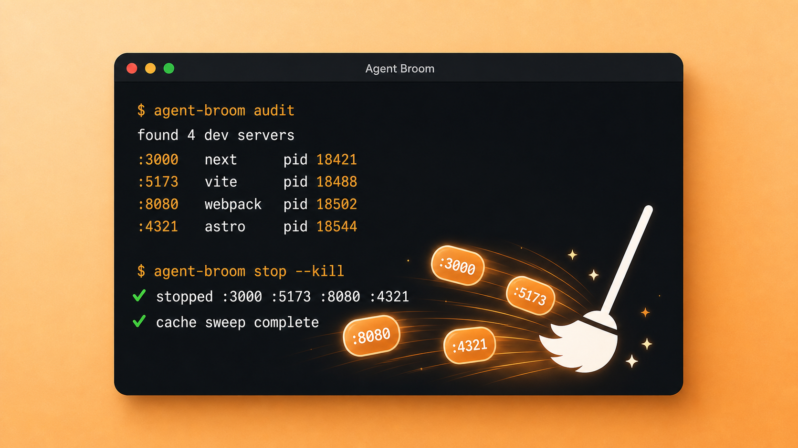

<p align="center">
  
</p>

<h1 align="center">Afterparty</h1>

<p align="center">
  A skill that makes agents clean up after the party.
</p>

<p align="center">
  
</p>

Afterparty is for the boring mess that coding agents leave behind: localhost
servers, test watchers, orphaned MCP processes, browser automation, build
artifacts, and dev caches.

The design is intentionally split:

- **The skill is memory.** It tells the agent when to run cleanup.
- **The script is machinery.** It audits, reports, and only acts after review.

No giant prompt cleanup ritual. No guessing from `ps` after the fact. Run the
script, inspect the dry run, then choose whether to apply anything.

## Requirements

- macOS or Linux with bash. On Windows, run under Git Bash or WSL.
- [ripgrep](https://github.com/BurntSushi/ripgrep) (`rg`) for process matching;
  the audit falls back to `grep -E` when it is missing.
- `lsof` (optional) for the localhost listener report.
- macOS-only devclean steps (`launchctl` agents, Xcode caches, iOS simulators)
  are skipped on other platforms.

## Install

### As a Claude Code plugin

```text
/plugin marketplace add Wenjix/afterparty
/plugin install afterparty@afterparty
```

The plugin also ships a `SessionEnd` hook: when a session ends it runs
`afterparty audit --report`, so the leftovers report is already on disk when
the next session starts.

### As a plain agent skill

Afterparty follows the [Agent Skills](https://agentskills.io) standard. The
skill folder is self-contained — `SKILL.md` plus the scripts it runs — so
copying it installs everything. For Claude Code:

```bash
cp -r skills/afterparty ~/.claude/skills/
```

Other Agent Skills-compatible tools (OpenCode, Goose, Amp, Cursor, Gemini CLI,
and more) install the same way: drop `skills/afterparty/` into that agent's
skills directory. Note: claude.ai web sessions load the skill instructions but
cannot execute the bundled bash scripts.

### As a standalone CLI

```bash
git clone https://github.com/Wenjix/afterparty.git
cd afterparty
bin/afterparty audit
```

Or add the `bin` directory to your shell path:

```bash
export PATH="$PWD/bin:$PATH"
afterparty audit
```

## Commands

```bash
afterparty list
afterparty list --json
afterparty audit
afterparty audit --kill tests,dev
afterparty audit --json
afterparty audit --report
afterparty add --pid <PID> --kind dev --port <PORT> --purpose "<why>" -- <command>
afterparty stop
afterparty stop --kill
afterparty prune
afterparty git
afterparty git --clean
afterparty artifacts
afterparty artifacts --clean
afterparty devclean
afterparty devclean --deep
afterparty devclean --optimize
afterparty devclean --disk
afterparty devclean --apply
afterparty doctor
```

Everything risky is dry-run first. `stop` reports what it would stop unless you
pass `--kill`. `audit` reports unless you pass `--kill <tests|dev|browser>`.
`git` reports session leftovers unless you pass `--clean`. `artifacts` reports
reclaimable build/cache output unless you pass `--clean`. `devclean` reports
safe orphan/deep/optimize/disk targets unless you pass `--apply`.

There are two kill paths: `stop --kill` stops process groups previously
recorded in the ledger, while `audit --kill <tests|dev|browser>` kills stray
processes matched by category pattern (pass `--keep <pgid>` to spare one).

Audits speak agent, too. `--json` on `audit`, `list`, and `git` emits one JSON
object per finding (JSON Lines). `audit --report` saves the report for the
next session: to `report.md` at the repo root when the repo gitignores that
name, otherwise to `~/.cache/agent-processes/report.md` — so a cleanup tool
never litters your repos. Add `report.md` to a repo's `.gitignore` to opt in
to per-repo reports.

## What It Tracks

`afterparty add` records long-running processes in:

```text
~/.cache/agent-processes/ledger.tsv
```

Each entry includes repo root, cwd, PID, PGID, kind, port, purpose, and command.
That means the next agent can see what is running and why before starting yet
another server on `localhost:3000`.

## What It Audits

`afterparty audit` reports:

- recorded agent-owned processes
- localhost listeners that look like dev servers
- test/watch runners such as Vitest, Jest, and pytest
- frontend/backend dev servers such as Next, Vite, Turbo, Bun, Uvicorn, and Rails
- automation browsers
- git session litter: stale worktrees, agent branches, conflict files, stashes
- protected processes that should not be killed

Afterparty protects editors, Codex, shells, and shared MCP servers such as
`playwright-mcp` and `chrome-devtools-mcp`.

## Git Cleanup

Agent fleets work through worktrees and branches, then vanish. `afterparty git`
reports what they left behind, and `--clean` applies only the safe subset:

- prune worktree admin data whose directory is already gone
- remove **clean** worktrees idle past `--age` days (default 7; never `--force`)
- delete agent-named branches (`claude/*`, `codex/*`, `cursor/*`, ...) that are
  **merged** into HEAD (`-d`, never `-D`)
- remove a `.git/index.lock` older than 60 minutes
- delete **untracked** merge-conflict litter (`*.orig`, `*.rej`, `*.BACKUP.*`, ...)

Unmerged branches, dirty worktrees, and stashes are report-only, always — the
report names the manual command instead of guessing for you.

## Devclean Mode

`afterparty devclean` borrows the useful shape of `devclean`: safe orphan
cleanup, explicit deep cleanup, optimize mode, and disk mode.

```bash
afterparty devclean
afterparty devclean --deep
afterparty devclean --optimize
afterparty devclean --disk
```

It is conservative by default. It does not treat every `crashpad_handler` as a
safe orphan because normal active apps on macOS use those helpers. Crashpad file
cleanup and crash reporter settings live behind `--optimize`, where you can
review the exact targets first.

## Artifact Cleanup

`afterparty artifacts` reports rebuildable repo artifacts:

- `.turbo`, `.vite`, `.cache`, `node_modules/.cache`
- `.next`, `dist`, `build`, `out`, `.output`
- `*.tsbuildinfo`, `.eslintcache`
- `coverage`, `test-results`, `playwright-report`

It skips git-tracked paths and nested git repositories.

## Agent Skill

The reusable agent memory hook lives in:

```text
skills/afterparty/SKILL.md
```

The skill folder bundles the `bin/` and `lib/` scripts it runs, and its
commands are anchored with `${CLAUDE_SKILL_DIR}` so they work from any project
the agent happens to be in. The skill should stay small. The script does the
work.

## Safety Model

- Dry-run by default.
- Kill by process group only after ownership is clear.
- Prefer SIGTERM, then SIGKILL only for stragglers.
- Never kill the editor, Codex, the user's shell, or shared MCP servers unless
  the script proves they are safe orphaned targets.
- Delete only known rebuildable artifacts.

## License

MIT
