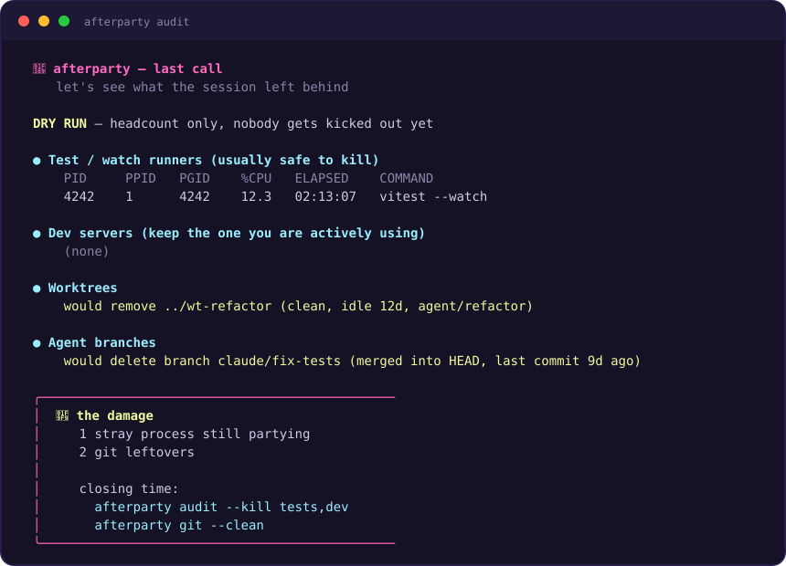

<p align="center">
  
</p>

<h1 align="center">Afterparty</h1>

<p align="center">
  Cleanup for the mess coding agents leave behind.
</p>

<p align="center">
  
</p>

An agent session ends and leaves things behind: a dev server still bound to
`localhost:3000`, a Vitest watcher no one is watching, a headless Chrome with
no owner, worktrees and `claude/*` branches no one will return to, and a
gigabyte of `.next` and `node_modules/.cache`.

Afterparty finds all of it, reports exactly what it found, and changes
nothing until you approve.

## Why Afterparty

- **One audit, the whole mess.** Processes, ports, watchers, automation
  browsers, git session litter, rebuildable artifacts, dev caches — one
  command, one report.
- **It reports to the next agent, not just to you.** `--json` emits JSON
  Lines, and `audit --report` persists a Markdown report — so the next
  session starts by reading what the last one left running instead of
  starting yet another server on `localhost:3000`.
- **Dry-run isn't a mode, it's the default.** Every mutation hides behind an
  explicit flag — `--kill`, `--clean`, `--apply` — scoped to exactly what the
  dry run showed you.
- **Protected processes are never killed.** Editors, interactive shells,
  Codex, and shared MCP servers sit on a protect list that every kill path
  checks before every signal.
- **No prompt rituals, no guessing from `ps` output.** Cleanup is a script
  you can read, with a dry run you can inspect, not a wall of instructions
  the agent half-remembers.
- **Tested where it counts.** CI runs the suite on Linux and Windows, and the
  kill paths are exercised against live processes — not mocks.

## Install

### As a Claude Code plugin

```text
/plugin marketplace add Wenjix/afterparty
/plugin install afterparty@afterparty
```

The plugin does two things a bare skill can't:

- a `SessionEnd` hook runs `afterparty audit --report` when a session ends,
  so the leftovers report is already on disk when the next session starts;
- a `/afterparty` slash command runs the audit on demand
  (`/afterparty clean` walks the gated cleanup paths).

### As a plain agent skill

Afterparty follows the [Agent Skills](https://agentskills.io) standard, and
the skill folder is self-contained — `SKILL.md` plus every script it runs,
with commands anchored to `${CLAUDE_SKILL_DIR}` so they work from whatever
project the agent happens to be in. Copying the folder is the whole install.
For Claude Code:

```bash
cp -r skills/afterparty ~/.claude/skills/
```

OpenCode, Goose, Amp, Cursor, Gemini CLI, and other Agent Skills-compatible
tools install the same way: drop `skills/afterparty/` into that agent's
skills directory. (claude.ai web sessions load the skill's instructions but
cannot execute the bundled scripts.)

The skill itself stays tiny by design. It is the *when* — a memory hook that
reminds the agent cleanup is due. The scripts are the *how*, and they are the
only thing that ever acts.

### As a standalone CLI

```bash
git clone https://github.com/Wenjix/afterparty.git
cd afterparty
bin/afterparty audit
```

Or put `bin` on your path:

```bash
export PATH="$PWD/bin:$PATH"
afterparty audit
```

## Commands

Every command reports first. The right-hand column is the only way anything
gets touched.

| Command | Reports | Acts with |
| --- | --- | --- |
| `afterparty audit` | recorded processes, dev servers, watchers, browsers, git litter | `--kill tests\|dev\|browser` |
| `afterparty stop` | ledger-recorded process groups | `--kill` |
| `afterparty git` | stale worktrees, agent branches, lock files, conflict litter | `--clean` |
| `afterparty artifacts` | rebuildable build/cache output | `--clean` |
| `afterparty devclean` | orphans, plus `--deep` / `--optimize` / `--disk` targets | `--apply` |

The bookkeeping commands — `list`, `add`, `prune` — only ever touch
Afterparty's own ledger, never your system. `doctor` runs every dry-run
report in one pass and changes nothing.

```bash
afterparty audit                   # full dry-run report
afterparty audit --json            # same findings, as JSON Lines
afterparty audit --report          # persist the report for the next session
afterparty audit --kill tests,dev  # kill stray watchers and dev servers
afterparty add --pid <PID> --kind dev --port <PORT> --purpose "<why>" -- <command>
afterparty list --json             # the ledger, for machines
afterparty stop --kill             # stop this repo's recorded groups
afterparty prune                   # drop this repo's dead ledger entries
afterparty git --clean             # apply the safe git subset
afterparty artifacts --clean       # delete rebuildable artifacts
afterparty devclean --disk         # report disk-heavy targets
afterparty doctor                  # every dry-run report in one pass
```

The ledger commands (`list`, `stop`, `prune`) scope to the current repo by
default; pass `--all` to cover every repo, or `--root <dir>` for another.

There are two kill paths, and they answer different questions. `stop --kill`
stops what Afterparty *recorded*: process groups from the ledger, where
ownership is already established. `audit --kill <tests|dev|browser>` handles
the strays nobody recorded, matched by category pattern. Both accept
`--keep <pgid>` to spare a group.

## Reports that outlive the session

The post-session report is the point, so it comes in three shapes:

- **Styled**, on an interactive terminal — for you (see [Style](#style)).
- **JSON Lines**, via `--json` on `audit`, `list`, and `git` — one JSON
  object per finding, for agents and scripts.
- **Persisted**, via `audit --report` — written to `report.md` at the repo
  root *only* when the repo already gitignores that name (a cleanup tool must
  not litter your repos), otherwise to `~/.cache/agent-processes/report.md`.
  Add `report.md` to a repo's `.gitignore` to opt in to per-repo reports. The
  plugin's `SessionEnd` hook leans on this.

## The ledger

`afterparty add` records long-running processes in
`~/.cache/agent-processes/ledger.tsv` — repo root, cwd, PID, PGID, kind,
port, purpose, and command. The result: the next agent can see what is
running *and why* before spinning up a duplicate.

## The audit

`afterparty audit` reports:

- processes recorded in the ledger
- localhost listeners that look like dev servers
- test/watch runners such as Vitest, Jest, and pytest
- frontend/backend dev servers such as Next, Vite, Turbo, Bun, Uvicorn, and
  Rails
- automation browsers
- git session litter: stale worktrees, agent branches, conflict files, stashes
- protected processes it will refuse to kill

The protect list covers editors, interactive shells, Codex, and shared MCP
servers such as `playwright-mcp` and `chrome-devtools-mcp`.

## Git cleanup

Agent fleets work through worktrees and branches, then vanish. `afterparty
git` reports what they left behind; `--clean` applies only the provably safe
subset:

- prune worktree admin data whose directory is already gone
- remove **clean** worktrees idle past `--age` days (default 7; never
  `--force`)
- delete agent-named branches (`claude/*`, `codex/*`, `cursor/*`, ...) that
  are **merged** into HEAD (`-d`, never `-D`)
- remove a `.git/index.lock` older than 60 minutes
- delete **untracked** merge-conflict litter (`*.orig`, `*.rej`,
  `*.BACKUP.*`, ...)

Unmerged branches, dirty worktrees, and stashes are report-only, always. For
those, the report names the exact manual command instead of guessing for you.

## Artifacts

`afterparty artifacts` reports rebuildable repo output:

- `.turbo`, `.vite`, `.cache`, `node_modules/.cache`
- `.next`, `dist`, `build`, `out`, `.output`
- `*.tsbuildinfo`, `.eslintcache`
- `coverage`, `test-results`, `playwright-report`

It skips git-tracked paths and nested git repositories.

## Devclean

`afterparty devclean` borrows its shape from the `devclean` utility: safe
orphan cleanup by default, with explicit escalation modes.

```bash
afterparty devclean            # safe orphan cleanup
afterparty devclean --deep     # deep cleanup targets
afterparty devclean --optimize # crashpad files, crash-reporter settings
afterparty devclean --disk     # disk-heavy caches and artifacts
```

It is conservative on purpose. It does not treat every `crashpad_handler` as
a safe orphan — active apps on macOS use those helpers — so crashpad cleanup
lives behind `--optimize`, where you review the exact targets first. Codex
session transcripts are age-gated: only date folders older than 30 days
(override with the `CODEX_SESSION_AGE_DAYS` environment variable) are
eligible, because transcripts
power resume and are the audit trail of what your agents actually did. The
shared pnpm store is pruned (`pnpm store prune`, unreferenced packages
only), never deleted outright — other projects still link into it. Scope
the `--disk` project scan with `--documents-root DIR` and
`--project-maxdepth N`, and skip the current-repo artifact pass with
`--no-repo-artifacts`.

## Style

On an interactive terminal, audits end with color, glyph headers, and a
finale card — a **damage report** when leftovers exist, **confetti** when
nothing is left, a **receipt** after a cleanup. Styling is strictly additive: pipes, `--json`, and `report.md`
always get byte-stable plain text, `NO_COLOR` is honored, and
`AFTERPARTY_STYLE=always|never|auto` overrides everything (precedence:
`AFTERPARTY_STYLE` > `NO_COLOR` > tty detection).

## Safety model

- Dry-run by default; mutations only behind explicit flags.
- Two kill disciplines, both deliberate. Ledger and audit kills go by process
  group — SIGTERM first, SIGKILL only for stragglers — and skip any group
  containing a protected process. Devclean's orphan cleanup signals
  individual PIDs instead, because orphans can share a group with unrelated
  processes, and group-kill would take those out too.
- The protect list — editors, interactive shells, Codex, shared MCP
  servers — is checked before every signal.
- Artifacts: delete only known rebuildable output, skipping git-tracked paths
  and nested repos.
- Git: apply only the safe subset; everything ambiguous stays report-only,
  with the manual command spelled out.

## Requirements

- macOS or Linux with bash. On Windows, run under Git Bash or WSL.
- [ripgrep](https://github.com/BurntSushi/ripgrep) (`rg`) for process
  matching; the audit falls back to `grep -E` when it is missing.
- `lsof` (optional) for the localhost listener report.
- macOS-only devclean steps (`launchctl` agents, Xcode caches, iOS
  simulators) are skipped on other platforms.

## Development

```bash
bash -n bin/afterparty     # syntax check
bash tests/run.sh          # test suite
claude plugin validate .   # plugin manifests
```

CI runs the suite on Ubuntu and Windows. The Ubuntu job exercises the kill
paths against live processes (`tests/test-kill.sh`), and shellcheck runs at
`--severity=error`.

## Lineage

Afterparty combines my own cleanup skills and methods with
[Agent-Broom](https://github.com/Kevin-Liu-01/Agent-Broom) by Kevin Liu.
The project began as a fork of Agent-Broom, which contributed the
foundation — the process ledger, the audit/stop split, and the dry-run-first
discipline — and the LICENSE retains Kevin Liu's copyright line. On that
base I built out my own methods: the git session cleanup, the devclean
policies, the agent-facing JSON and report output, the plugin packaging,
the styling layer, and the test suite. The devclean mode borrows its shape
from the `devclean` utility.

## License

MIT — see [LICENSE](./LICENSE).
