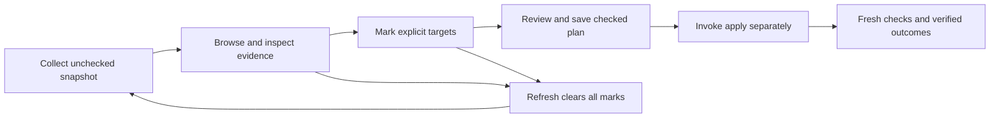

# Terminal UI design specification

Status: accepted design direction, October 2026. Commit `9210b5e` merged the
first C+A guided reviewer on 2026-10-21. The changelog lists 0.14.0 as Unreleased.
This document retains the broader design intent and illustrative comparisons.
[README](../../README.md) describes the implemented CLI contract. The
[implementation status](terminal-ui-implementation.md) covers the reviewer,
responsive reports, and structured apply receipts.

The optional dashboard remains a separate proposal.

The build-output inventory extends this terminal surface. It uses the same
helper, theme, scrolling list, focus strip, inspection, and contextual controls.
It is a read-only report across explicitly selected project roots. It has no
marks or save step. Enter opens a fresh artifact review for the focused
repository. The [inventory contract](../build-inventory.md) defines its scope,
measurements, growth history, and failure states.

The 2026-10-12 implementation correction selects Bubble Tea and Lip Gloss for
the existing C+A flow and changes Enter to advance, with `i` for inspection.
The 2026-10-18 polish adopts the focus-strip layout: one compact row per target
in Choose, with a consequence preview pinned below the list. The
original HTML comparison and PNGs retain their earlier rows and key labels as
dated layout references. The keys below and the README describe current behavior.

Afterparty should make three questions easy to answer in a terminal:

- What remains?
- Why is a target offered or withheld?
- What would a reviewed choice do?

The preferred experience combines C's guided steps with A's polished text.
Start compact and offer a visible key to expand details. Improve shared CLI
presentation and add a reviewer that humans invoke explicitly. The reviewer
saves choices. Execution requires a separate `afterparty apply` step.

## Design package

- [Interactive comparison](mockups/terminal-ui-comparison.html): four proposed
  layouts, keyboard interactions, light/dark/monochrome presentations,
  60/80/120-column modes, and complete/incomplete/empty fixtures. C+A opens by
  default; press `d` to compare compact and expanded detail. Open the HTML
  file locally; it has no external dependencies or host-system access.
- [Concept comparison board](mockups/concept-board.png): an AI-generated visual
  earlier exploration of the four approaches, before the C+A preference. It uses
  a simplified five-target example; the exact six-target fixture below and
  interactive mockup govern behavior.
- [Implementation specification](terminal-ui-implementation.md): data contracts,
  module boundaries, phased changes, compatibility requirements, and validation.
- [Primary-source references](terminal-ui-references.md): open source patterns,
  optional tool choices, and their distribution tradeoffs.
- [Mockup gallery](mockups/README.md): dark/light screenshots, narrow and
  incomplete views, selected and saved-state previews, and a partial-apply
  receipt example.

All visual data is illustrative. The mockup simulates interaction and previews a
selection summary. It does not inspect the machine, save an executable cleanup
plan, signal processes, remove paths, or exercise real framework integrations.

## Product and scope

The primary user returns to a repository after agent work or reviews leftovers
before a handoff. They may use a split terminal or SSH, or prefer plain output.
Agents and shell pipelines also consume the existing CLI. The terminal reviewer
adds an interface that humans invoke explicitly.

Preserve the current product identity. Use modest magenta branding, cyan
headings, meaningful decision symbols, shared magnitude thresholds, and a little
party personality. Extend the terminal style in
[style.sh](../../skills/afterparty/lib/style.sh).

The initial reviewer covers the existing repository plan's three types:
process groups, worktrees, and artifacts. Machine-wide `devclean` targets use a
different approval model and remain a separate interface. Documentation review
remains an agent-led judgment workflow, outside target deletion selection.

Default scope is the current repository. Wider scope must explicitly show
which repositories contribute process and worktree proposals. Artifact scope
remains the selected repository. Worktree navigation in a full-screen mock does
not authorize `--all`.

## Four visual approaches

| Approach | Experience | Implementation direction | Relative cost |
| --- | --- | --- | --- |
| A. Polished CLI | Summary first, responsive text rows, clear scope and evidence status, concrete next command; stays in scrollback | Existing Bash renderers and shared `style.sh` | Smallest |
| B. Selector and evidence | Searchable available-target list, explicit marks, focused-target evidence preview, a separate withheld reader | Optional fzf adapter over one captured plan snapshot | Medium; alternative experiment |
| C+A. Guided review with expandable detail | Choose targets, review choices, save a plan; compact by default with polished stacked evidence on `d` | Bubble Tea input/rendering and Lip Gloss layout over the existing Python evidence/save backend | Preferred first interactive experience; no mandatory inspection step |
| D. Full review TUI | Category navigation, target list, evidence pane, persistent selection summary and contextual keys | Optional Bubble Tea/Lip Gloss adapter; Textual is a Python alternative | Largest; evaluate after the selector |

A is the presentation foundation. C+A is the preferred workflow after the user's
design feedback: one guided interface, with optional detail rather than another
dashboard or mandatory step. B remains a useful searchable alternative. D adds
terminal lifecycle, packaging, and maintained frontend work. These are proposed
Afterparty layouts inspired by the references, not screenshots or promises of
identical built-in components. A stock Gum chooser does not implement the proposed
`d` toggle or export its live marks on Escape; verify the input loop before
committing to that dependency. The reference note records the source evidence.

## Preferred C+A experience

The reviewer starts in a compact **Choose** step. A short fixed header shows
scope, local observation time, live snapshot age, scan completeness, and counts.
Each target has one row with a distinct label, type-specific measurement, and
availability. Related target types form sections. The backend orders the rows
so navigation follows the display. Withholding reasons remain visible as
sentences instead of internal reason codes.

A fixed focus strip identifies the target Space would mark and previews its
consequence. Withheld targets show their reason instead of an unavailable
action. The strip uses at most four rows: one identity row and up to three
consequence rows. Overflow ends with an `i: full detail` hint. Inspection and
Review choices show the complete consequence before the user saves.

The contextual legend names the `d` detail toggle. It produces single-column
stacked output with full identities, evidence checks, activity context, and full
consequences. Pressing it again returns to compact rows. The toggle changes the
current step's presentation. It does not change the command, proposal, or
adapter.

Keep the captured snapshot, scope, focused target, marked IDs, current step, and
query. The toggle never collects evidence, marks targets, saves files, advances
steps, or invokes apply.

The guided sequence is **Choose → Review choices → Save plan**. Enter advances
after the user explicitly marks targets. In Choose, `i` opens evidence for the
focused target. Escape returns to the same list and detail level.

Review choices opens compact with a three-row summary. It shows full selected
identities and consequences, including every process-group member. It supports
focus navigation and unmarking. Expanded Review adds evidence checks. Expanded
Save shows reviewed identities and consequences alongside the destination and
separate apply command.

Show the toggle only where it is active. Repeat the shortcut in contextual
help. Use printable `d` to avoid conflicts with terminal control chords.
In search or path-entry fields, `d` is ordinary input. The shortcut works only
in review navigation. Announce the new detail level and retained mark count.

Keep focus and marks visually distinct.

The explicitly invoked `afterparty review` command uses this compact default.
It preserves bare invocation, ordinary plan Markdown, agent commands, and plugin
hooks. When tools or an interactive terminal are absent, provide an explicit
CLI/manual-plan fallback. A hotkey, color theme, or ASCII mode alone does not
establish screen-reader accessibility. Check a stable linear text path
independently before making that claim.

## Shared illustrative fixture

Scope is `/work/afterparty`. The snapshot observation time is 14:23. Recorded
Codex activity contributing to the main repository is 18 hours old. The timestamp
describes file activity, not a visit, human presence, or proof of abandonment.

| Target | Type | Measurement or context | Proposal availability |
| --- | --- | --- | --- |
| `/work/afterparty/.next` | Artifact | 840 MB build output | Available |
| `/work/afterparty/playwright-report` | Artifact | 120 MB generated report | Available |
| `vite`, PGID 4821 | Process group | Members 4821/4822; peak CPU 0.2%; port 3000; recorded activity 18h ago | Available |
| `/work/afterparty-wt/docs-pass` | Worktree | 62 MB; clean and unoccupied; recorded activity unknown | Available |
| `/work/afterparty-wt/auth` | Worktree | 76 MB; occupied by PID 7304 | Withheld: occupied |
| Codex, PGID 9124 | Process group | Protected agent session | Withheld: protected |

The complete fixture has six observed targets, four available and two withheld.
The available artifact subtotal is 960 MB. The worktree measurement is shown
separately; process CPU and memory must not be added to a disk-size subtotal.
Observed directory sizes are estimates, not a guaranteed amount of freed storage.

Available filesystem examples assume complete identity, physical scope,
tracked-file, nested-repository, and occupancy checks, including worktree-specific
Git checks. Available process examples assume the existing eligibility, category,
protection, attribution, and fingerprint checks. The fixture illustrates their
results rather than claiming to run them.

## Information hierarchy

Every human-facing view follows this order:

1. Product, task, and explicit mode: `READ ONLY`, `PROPOSAL`, `REVIEW`, or `APPLY`.
2. Scope, observed time, and scan completeness.
3. Observed counts and type-specific measurements.
4. Targets with explicit availability or withholding reasons.
5. Focused-target evidence and consequence.
6. Current selection and a small, contextual next action or key legend.

Label targets available only after the plan's checks for that target type
succeed. Audit matches do not establish availability. The proposal mock depicts
a human rendering of `plan`. `audit` and `glance` report their own observations
and capabilities.

The composite audit's final card shows results. Styled mode can also show a
concise overview before sections. Use existing collected counters for this
overview. Do not run a second machine scan. Reports and pipes keep their
existing bytes.

### Three independent facts

- **Magnitude:** measured CPU, member count, elapsed time, and directory size.
  Existing severity thresholds remain centralized and indicate magnitude.
- **Availability:** available for selection or withheld with a specific reason.
  Available is not a guarantee that a later action will succeed.
- **Activity context:** recorded agent activity, its provider provenance, or
  unknown. Transcript evidence gates process proposals under current policy;
  it does not become a new veto for filesystem targets.

Use separate labels and fields for these facts. A worktree can be available
with unknown or recent activity. A quiet process can still be protected.
Green CPU text never authorizes process stopping.

## Responsive terminal layouts

Measure display cells rather than bytes or Unicode codepoints. Extend the
shared style helpers for terminal width and wrapping. Reuse distinct workspace
labels. Let users inspect full physical paths and group identities before they
save.

| Width | Proposed layout |
| --- | --- |
| 120 columns and above | C+A keeps one guided column; expanded text uses the extra width. B/D may use a list and evidence pane |
| 80 to 119 columns | C+A uses one-line compact targets with a pinned focus strip, or stacked expanded evidence; Enter advances and `i` inspects |
| 60 to 79 columns | Compact labels shorten without collisions; full identities and consequences remain available; scope, status and keys stay readable |
| Below 60 columns, or below 20 rows | Launch the reviewer into a readable size notice; preserve marks, block marking and saving, and suggest tmux `prefix z` |

Keep scope, scan status, mark count, and keys visible while the target list
scrolls. Show a position indicator when rows are off-screen. The position line
names the focused target and counts within the filtered list. Paging scrolls
without changing target focus. Space first reveals an off-screen focused target
without marking it.

Resizing changes presentation but keeps marks and identities. A confirmed
rescan creates a new proposal and clears marks.

Keep shortened target labels distinct. If labels collide at the current width,
add distinct ordinal prefixes. Process labels retain their full PGID. Wrap full
identities in the evidence view. A truncated label cannot be the only approval
evidence.

Test long paths with shared prefixes, spaces, CJK characters, and combining
marks. Continue refusing paths the backend cannot represent safely.

## Color, symbols, and copy

Use terminal foreground and background defaults in the CLI. The mockup's dark
and light backgrounds illustrate terminal themes. They do not set required
product colors. Support terminals without truecolor or Nerd Fonts. Avoid
requiring a particular terminal.

| Role | Presentation |
| --- | --- |
| Product | Modest magenta accent, one short banner |
| Heading | Cyan/bold; scope and actionable legend use the default foreground |
| Keyboard focus | Bold reverse using the terminal defaults, plus a visible focus cursor independent of selection |
| Unchecked / selected | `[ ]` / `[x]`; checked is a reviewed choice, not a completed operation |
| Withheld or refused | `⊘` and an explicit reason; ASCII `WITHHELD` or `REFUSED` |
| Confirmed completion | `✓` and a verified outcome; ASCII `DONE` |
| Incomplete evidence | Amber/bold text near scope and affected items |
| Execution failure | Red/bold text and an explicit outcome; ASCII `FAILED` |
| Informational message | Default foreground; sentence first and diagnostic code last |
| Secondary context | Dim only nonessential context; never the only explanation, scope or actionable key legend |

Monochrome retains every distinction through words, symbols, spacing, bold and
reverse focus. `NO_COLOR` removes hues while keeping those text attributes.
ASCII mode replaces decorative glyphs and meters without losing meanings.
Retain current `AFTERPARTY_STYLE`, `NO_COLOR`, `TERM=dumb`, per-stream TTY, and
`--json` precedence contracts. Any new settings need their own explicit tests.

Use factual task labels: `Process groups`, `Recorded groups`, `Withheld`,
`Scan incomplete`, `Reviewed plan saved`, and `Next step`. Keep the party voice
in a short introduction or closing line. Do not offer health scores, confidence
scores, or undo promises. Report partial evidence explicitly. It cannot support
a blanket success verdict.

## Review interaction

`afterparty review` captures one repository plan snapshot. Every proposal
starts unchecked. Arrow keys or j/k move focus. Space marks or unmarks an
available target. `i` opens evidence. Enter advances.

Navigation, highlighting, search, and inspection never select a target.

The list shows the target type, a distinct identity, applicable measurements,
and availability. Details answer what the target is, why it was offered or
withheld, and what applying its checkbox would do.

For process groups, show these facts:

- workspace, PGID, category, and every member;
- listening ports and peak observed CPU;
- recorded purpose and activity provenance;
- protection inspection and identity.

State that the action stops every group member with TERM, then KILL if needed.
State that the user must restart services manually.

For artifacts, show the full physical path, size, scope, occupancy, identity,
and rebuild consequences. Include tracked-file and nested-repository checks.
For worktrees, also show branch, cleanliness, ignored-file policy, and Git
administrative identity. Label activity as context for both filesystem types.

Withheld targets remain readable but have no checkbox or override. B presents
them in a separate reader outside fzf's selectable list. C and D can include
disabled rows that accept focus. Show the withholding reason in the interface.

### Keys and exit behavior

| Key | Meaning |
| --- | --- |
| Up/Down or j/k | Move focus without changing marks |
| PageUp/PageDown | Scroll content/evidence without moving target focus |
| Space | Toggle the focused available target; in Review, unmark it. If paging hid the focus, reveal it first |
| Enter | Advance through Review choices, Save plan and Finish; never implicitly mark the focused target. During search, finish the query only. |
| `i` | Inspect the focused target |
| `d` | Expand details / Compact view where offered; keep scope, snapshot, focus and marks |
| Escape | Leave the current detail, help or summary view; preserve marks and detail preference |
| `/` | Search when the chosen adapter supports it |
| Tab | Change panes in alternatives that have panes; C+A remains one column |
| `s` | Review selected actions before saving |
| `r` | Request a rescan; with marks, confirm once before clearing them and collecting a new snapshot |
| `?` | Show contextual help |
| `q` | Close help or inspection; otherwise cancel the draft, with one confirmation if marks would be discarded |
| Ctrl+Z | Suspend and resume the reviewer with its marks intact |

Filtering preserves explicit marks by item ID and keeps the total visible.
A confirmed refresh clears marks even if a familiar path or PGID still appears.
During the initial scan or refresh, the frontend ignores review actions.
q and Ctrl+C remain available. Each completed scan has a generation number.
The backend rejects mark/advance keys from older generations and reports the
ignored count.

Navigation bursts over SSH remain usable. Collection shows elapsed time without
an invented completion percentage. Zero marks cannot save an approved choice.
A selector's focused-row fallback does not prove an explicit mark. The adapter
must check marked IDs explicitly.

### Review and save

Review starts with a three-row summary of marked choices. It then lists full
identities and consequences for each target type. Process-group, worktree, and
artifact counts stay separate. Artifact byte subtotals and worktree sizes remain
deferred. Do not invent numeric totals from display tokens. Every process-group
member remains listed in compact Review.

`d` reveals evidence. Space unmarks the focused choice. Escape goes back.
Enter opens a separate Save plan step. Another Enter writes the explicitly
marked set. Focus alone does not approve a target.

Saving changes only selected checkboxes in the exact captured canonical
Markdown. It retains fingerprints and metadata. Before writing, check the
snapshot association and reject malformed or duplicate selection inputs.
Refuse an existing `--output` destination before collection. Explain how to
choose a new filename or use the default destination.

The writer must also check the destination again. A file can appear after
collection. Never overwrite an unrelated file silently. If saving fails,
report that no reviewed plan was saved. Keep the draft for retry.

After a successful real save, restore the terminal. List the saved choices
and destination. Print the shell-quoted `afterparty apply <saved-plan>` command
alone on one logical line. If `afterparty` is absent from PATH, use the
bundled CLI's absolute path. Copied display rows contain spaces rather than
hard tabs. The reviewer does not execute apply.

The mockup previews this state without writing a real plan.

When no targets are available, Enter finishes without saving. Incomplete
evidence remains visible and yields a nonzero result. This gives a review
containing only withheld targets a clear finish action.

## Missing evidence and incomplete outcomes

These states must be designed alongside the normal case:

- **No indexed activity:** a successful scan provides no timestamp for a
  workspace. Show unknown and the absence reason; dependent process proposals
  are withheld. Filesystem checks decide filesystem availability separately.
- **Failed activity inspection:** show incomplete status at the top, discard
  partial activity results and withhold dependent processes. In the shared
  fixture, if filesystem evidence remains complete, this leaves three available
  filesystem targets and three withheld targets.
- **Failed occupancy inspection:** visibly withhold affected filesystem targets;
  a failed scan is never an empty successful scan.
- **Complete empty result:** say no targets were observed in this scope, with a
  complete inspection status. Do not reuse this state for scanner failures.
- **Loading:** show the stage being inspected without inventing completion
  percentages or historical resource graphs from a single observation.
- **Changed identity:** require a new proposal rather than transferring a mark.
- **Partial apply:** list each confirmed, refused and failed outcome separately.
  A path remaining after a failed deletion can be partly changed, so do not call
  it retained without evidence.
- **Receipt write failure:** confirmed mutations remain confirmed and counted;
  receipt failure is a separate error and the overall operation is nonzero.

## Public help and return surfaces

Use `afterparty` in human help. Avoid internal script names and source comment
markers. Group commands by inspect, review, apply, and history. Show one current
post-session workflow. Label report-only commands where the user makes a
decision. Preserve error exit codes and command-specific flag rejection.

`glance` remains read-only and process-focused. Its human view should prioritize
workspace identity, resource magnitude, recorded activity provenance and evidence
availability. Unknown/cwd-only rows remain visible. The table must not imply
confirmed workspace ownership or infer staleness from process liveness.

Lifecycle hooks remain bounded and noninteractive. SessionStart reads saved
summaries. SessionEnd records its existing marker. No hook starts a TUI.

## Delivery order and acceptance

1. Polish help, width-aware human output, scope/completeness hierarchy, and
   factual summaries using shared render helpers. Preserve plain/JSON contracts.
2. Introduce one structured plan snapshot, generated alongside the existing
   Markdown from the same observations.
3. Build the preferred compact guided reviewer with an owned selection state and
   a `d` toggle into polished detail. Verify Gum/input-loop feasibility before
   choosing the adapter. Test zero-mark refusal, preserved state on detail/back,
   and refresh clearing. Keep fzf as an alternative against the same snapshot.
4. Add explicit structured apply outcomes before a maintained dashboard needs
   execution receipts. All adapters use the same plan contract and safety engine.
5. Consider a full-screen optional adapter only after the compact workflow is
   useful; preserve the portable core and standalone skill distribution.

Acceptance requires complete/narrow/unknown/incomplete/empty and partial-outcome
examples, readable monochrome/ASCII views, intact unique identities, no marks
on refresh, and an explicit separate apply step. New destructive-policy guards
must have isolated regression tests whose reachability is proven and whose
production mutation makes the test fail. The technical spec defines the
corresponding public-CLI tests and release/documentation requirements.

## Remaining choices

The preferred first prototype direction is C+A, starting compact and guided.
The `d` toggle is part of that interaction contract. B and D remain alternatives
for comparison, not additional mandatory features. The input renderer, optional
dependency installation, exact release pins, and any full-screen adapter remain
implementation decisions to verify at build time. These mockups do not establish
that a framework is installed, integrated, or tested on all supported terminals.
